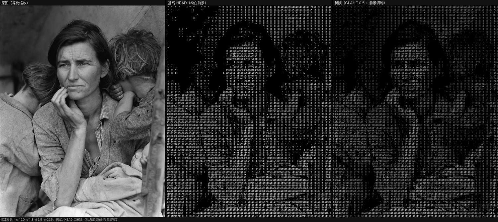
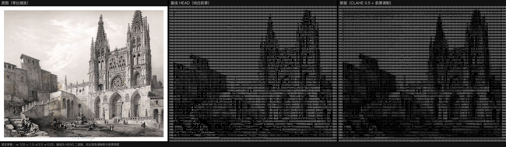
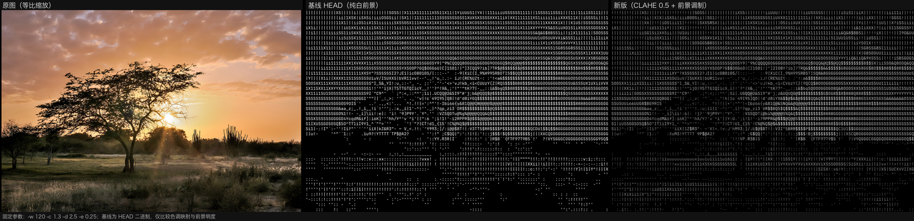

# ASCII Image Studio

将图片转换为黑底、等宽字符画。字符由字体 6D 形状向量匹配，并用 DoG、Sobel 和外部邻域方向增强保留轮廓。

## 构建

```bash
cargo build --release
```

可执行文件位于 `target/release/ascii-image-studio`。字体已内嵌，运行时不依赖系统字体。

## 使用

```bash
./target/release/ascii-image-studio photo.jpg
```

终端输出未指定 `--width` 时按窗口列数取宽；输出文件或重定向时默认 120 列。

```bash
./target/release/ascii-image-studio photo.jpg --width 100 --color
```

```bash
./target/release/ascii-image-studio photo.jpg --dither --output portrait.txt
```

```bash
./target/release/ascii-image-studio photo.jpg --braille --dither --output portrait.png
```

| 参数 | 默认值 | 说明 |
| --- | --- | --- |
| `-w, --width` | 终端宽度 / 120 | 输出字符列数；显式值优先 |
| `-o, --output` | 终端 | 输出文件；扩展名决定格式 |
| `-c, --contrast` | `1.3` | 对比度幂指数，作用于色调映射后的亮度 |
| `--tone-map` | `clahe` | `clahe` 局部均衡；`global` 全局 1%–99% 拉伸（旧版色调曲线） |
| `-d, --dir-crunch` | `2.5` | 外部邻域方向锐化指数 |
| `-e, --edge-weight` | `0.25` | DoG 与 Sobel 边缘权重；0 表示关闭 |
| `--dither` | 关闭 | ASCII 用 Floyd–Steinberg；盲文用 2x4 Bayer 有序抖动 |
| `--color` | 关闭 | 保留原图高亮区域颜色 |
| `--braille` | 关闭 | 使用 2x4 盲文点阵字符 |

## 色调映射

`--tone-map clahe`（默认）把亮度分成最多 8x8 块，逐块限幅并重分配直方图，再用双线性插值消除块边界。纯色块保持原值。局部结果与全局拉伸各占一半，以压低平滑天空和纸张上的噪点。

`--tone-map global` 保留旧版色调曲线：全局 1%–99% 拉伸，再乘对比度幂指数。低对比或噪点明显的图片可改用它。

`--contrast` 在色调映射之后生效，两种模式的语义相同。

## 前景明度

黑白输出按单元真实亮度调制前景：

```text
I_fg = 0.25 + 0.75 * Y_cell
```

`Y_cell` 是单元内合成到黑底后的平均亮度，不经过 CLAHE、拉伸或边缘增强。暗处字符因此不会保持纯白。`--color` 保留真实 RGB，不做这层调制。`.txt` 只有字符，没有色调。

## 抖动

ASCII 的 `--dither` 只扩散整体密度误差。方向增强与不加 `--dither` 时同一步、只做一次；选字前把增强后的 6D 形状按一个比例缩放到目标密度，分量比值不变。有分量到 1.0 时整体停止放大，达不到的密度作为残差继续扩散。零向量没有方向，按面积均分。

盲文使用标准 Unicode 点位，2x4 点阵对应关系为 `[[0,3],[1,4],[2,5],[6,7]]`。`--braille --dither` 使用 2x4 Bayer 有序抖动；不加 `--dither` 时按 0.5 阈值二值化。盲文没有字形方向选择，`--dir-crunch` 只影响 ASCII 字符匹配。

## 输出

- `.txt`：纯文本，不包含 ANSI 转义序列。
- `.ans`：24-bit ANSI，黑底前景色。
- `.png`：黑底无损图片，宽高为字符列数乘 10、行数乘 20。
- 终端：24-bit ANSI，黑底前景色。

透明像素先合成到黑底。盲文 PNG 使用标准 2x4 点阵位图绘制，不依赖字体盲文字形。

## 展示

样本为逆光风景（CC0，见下方许可）。四张图使用同一输入，`-w 80`。

| 原图 | 标准 ASCII | 彩色 | 盲文 |
| --- | --- | --- | --- |
|  |  |  |  |

盲文展示使用 `--braille --dither`。

## 前后对比

三组图同源同参：`-w 120 -c 1.3 -d 2.5 -e 0.25`，不加 `--dither`，差异只来自色调映射与前景明度。从左到右依次为原图（等比缩放）、基线 HEAD（`d30ea73`，纯白前景）、新版（`51534cf`，CLAHE 0.5 + 前景调制）。三组的新版整体更暗。

### 人像



暗部字符亮度降低，脸颊和衣服褶皱出现明暗过渡。

### 线稿



墨迹亮度跟随纸面亮度，拱券和窗花格的字符方向保留。

### 风景



树叶和草地的孤立亮点减少，天空渐变更平顺。

## 参数网格

`scripts/compare-grid.sh` 生成 `--dir-crunch` 与 `--edge-weight` 的 3x3 拼图，并在每格标注实际参数：

```bash
cargo build --release
scripts/compare-grid.sh photo.jpg
```

输出在 `output/compare/<图片名>/grid.png`。拼图步骤需要 Python 3 和 Pillow，仅用于开发比较，不是运行时依赖。

## CI

`.github/workflows/ci.yml` 在推送和拉取请求时执行：

- `cargo fmt --check`
- `cargo clippy --all-targets --all-features -- -D warnings`
- `cargo test --all-targets --all-features`
- 构建 Linux x86_64、macOS arm64、macOS x86_64、Windows x86_64 四个 target，并上传二进制 artifact。

工作流只在本地做过静态检查，尚未在 GitHub 云端执行。

## 许可

内嵌字体为 [JetBrains Mono Regular](https://github.com/JetBrains/JetBrainsMono)，按 SIL Open Font License 1.1 使用。许可证见 `assets/OFL.txt`。

展示用样本均取自 Wikimedia Commons：

- 人像：[Migrant Mother](https://commons.wikimedia.org/wiki/File:Migrant_Mother_%28LOC_fsa.8b29516%29.jpg)，作者 Dorothea Lange（美国国会图书馆），Public domain，无已知发布限制。
- 线稿：[Main facade Cathedral of Burgos 1850 Villaamil](https://commons.wikimedia.org/wiki/File:Main_facade_Cathedral_of_Burgos_1850_Villaamil.jpg)，绘图 Genaro Pérez Villaamil；版画 Charles Claude Bachelier；1850，Public domain（PD-old-100、PD-Scan）。
- 风景：[Backlit Margarita Island Sunset in Las Guevaras, Venezuela](https://commons.wikimedia.org/wiki/File:Backlit_Margarita_Island_Sunset_in_Las_Guevaras,_Venezuela_CaptureNX2.jpg)，作者 Wilfredor，CC0 1.0。

`docs/` 下的对比图由这些样本渲染后拼接，许可同上。
