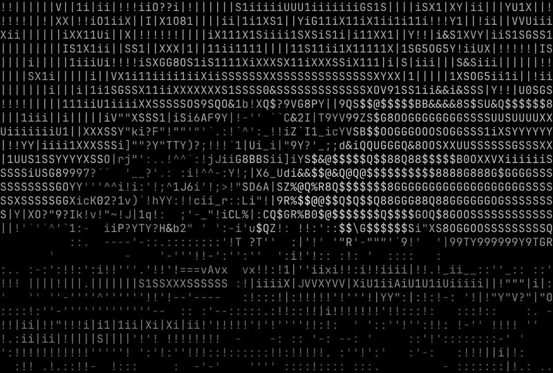
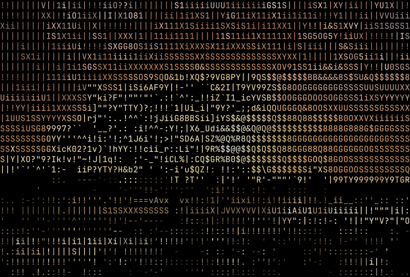
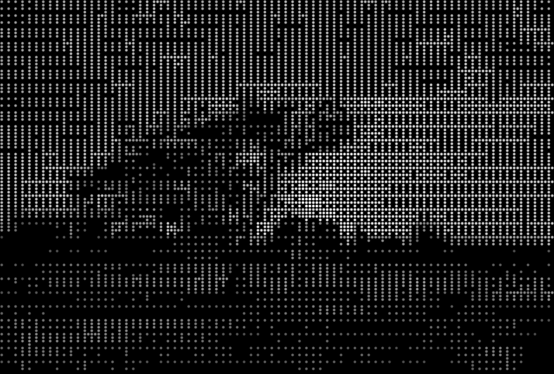

# ASCII Image Studio

将图片转换为黑底、等宽字符画。字符按字体的 32 维（4x8 子块）形状向量匹配，并用有符号 DoG 锐化和 Sobel 方向特征保留轮廓。

## 构建与使用

```bash
cargo build --release
./target/release/ascii-image-studio photo.jpg
```

字体已内嵌，运行时不依赖系统字体。终端输出未指定 `--width` 时取窗口列数；输出到文件或重定向时默认 160 列。

```bash
./target/release/ascii-image-studio photo.jpg --braille --dither --color -o portrait.png
```

| 参数 | 默认值 | 说明 |
| --- | --- | --- |
| `-w, --width` | 终端宽度 / 160 | 输出字符列数；显式值优先 |
| `-o, --output` | 终端 | 输出文件；扩展名决定格式 |
| `-c, --contrast` | `1.1` | 对比度幂指数，作用于色调映射后的亮度 |
| `--tone-map` | `clahe` | `clahe` 局部均衡；`global` 全局 1%–99% 拉伸（旧版色调曲线） |
| `-d, --dir-crunch` | `1.4` | 形状向量相对亮度密度的权重；强边缘提高，平坦区域降低 |
| `-e, --edge-weight` | `0.25` | 有符号 DoG 锐化权重；0 表示关闭 |
| `--dither` | 关闭 | ASCII 用 Floyd–Steinberg；盲文用 2x4 Bayer 有序抖动 |
| `--color` | 关闭 | 保留原图高亮区域颜色 |
| `--braille` | 关闭 | 使用 2x4 盲文点阵字符 |

## 处理说明

- 默认 `--tone-map clahe` 按块限幅（clip limit 1.8）并重分配直方图，再插值消除块边界。低对比或噪点明显的图片可改用 `global`。
- `--contrast` 在色调映射之后生效，两种模式语义相同。
- 黑白输出按单元真实亮度调制前景：`alpha = 0.25 + 0.75 * Y_cell^0.85`。匹配时形状按字形覆盖率比较，平均亮度由 `alpha × 字形密度` 正则项补偿，避免中间调二次压暗。`--color` 保留真实 RGB，不做这层调制。
- `-e` 使用有符号 DoG 非锐化掩模，边缘亮侧更亮、暗侧更暗；Sobel 仅提供方向和边缘强度，不再把梯度幅值加进亮度。
- 盲文没有字形方向选择，`--dir-crunch` 只影响 ASCII 字符匹配。
- 透明像素先合成到黑底。

## 输出格式

| 扩展名 | 内容 |
| --- | --- |
| `.txt` | 纯文本，无 ANSI 转义序列 |
| `.ans` | 24-bit ANSI，黑底前景色 |
| `.png` | 黑底无损图片，每字符格 10x20 像素 |
| 终端 | 24-bit ANSI，黑底前景色 |

盲文 PNG 按标准 2x4 点阵位图绘制，不依赖字体盲文字形。

## 示例

输入同为逆光风景（CC0），`-w 80`：

| 原图 | 标准 ASCII | 彩色 | 盲文 |
| --- | --- | --- | --- |
|  |  |  |  |

盲文示例使用 `--braille --dither`。

## 开发

`scripts/compare-grid.sh photo.jpg` 生成 `--dir-crunch` 与 `--edge-weight` 的 3x3 拼图，输出 `output/compare/<图片名>/grid.png`。拼图需要 Python 3 与 Pillow，仅用于开发比较。

CI 在推送和拉取请求时运行 `cargo fmt --check`、`cargo clippy --all-targets --all-features -- -D warnings`、`cargo test --all-targets --all-features`，并构建 Linux x86_64、macOS arm64、macOS x86_64、Windows x86_64 四个平台的二进制。工作流尚未在 GitHub 云端执行。

## 许可

内嵌字体为 [JetBrains Mono Regular](https://github.com/JetBrains/JetBrainsMono)，按 SIL Open Font License 1.1 使用。许可证见 `assets/OFL.txt`。

示例图片取自 Wikimedia Commons：

- 人像：[Migrant Mother](https://commons.wikimedia.org/wiki/File:Migrant_Mother_%28LOC_fsa.8b29516%29.jpg)，作者 Dorothea Lange（美国国会图书馆），Public domain。
- 线稿：[Main facade Cathedral of Burgos 1850 Villaamil](https://commons.wikimedia.org/wiki/File:Main_facade_Cathedral_of_Burgos_1850_Villaamil.jpg)，绘图 Genaro Pérez Villaamil；版画 Charles Claude Bachelier；1850，Public domain（PD-old-100、PD-Scan）。
- 风景：[Backlit Margarita Island Sunset in Las Guevaras, Venezuela](https://commons.wikimedia.org/wiki/File:Backlit_Margarita_Island_Sunset_in_Las_Guevaras,_Venezuela_CaptureNX2.jpg)，作者 Wilfredor，CC0 1.0。

`docs/` 下的图片由这些样本渲染拼接，许可同上。
